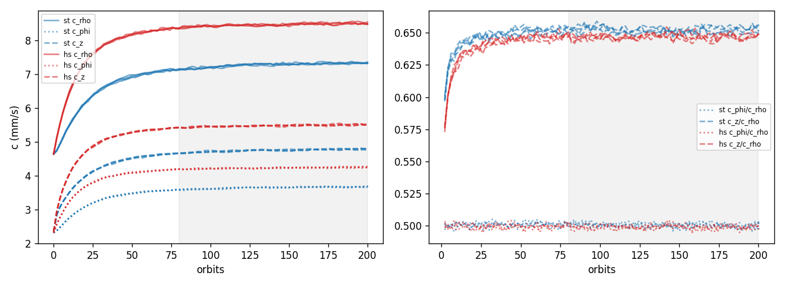

# K4 report: stochastic and hard-sphere models in an arc

Status: interim. Only τ = 0.1 is analysed. The τ = 0.4 runs are not started.
Analysis, scripts and numbers: A4 (2026-11-09). The A4 agent could not write this file (the Write tool refused it), so A0 wrote it from the A4 text and added section 8 and the A0 checks in section 7.

PLAN section 9, K4: compare the stochastic (ST) and hard-sphere (HS) models in a small arc for velocity dispersion and radial spreading rate. Done when the report shows agreement or explains the difference. A6 reviews this report without the A4 code.

No numeric agreement threshold was set before the runs. This report gives numbers and no pass or fail verdict on agreement.

## 1. Setup

| Item | Value |
|---|---|
| Particles | N = 10⁵, W = 1, radius s = 10 m (contact distance d = 2s = 20 m) |
| Domain | arc of 40 km (0.0163°), τ₀ = 0.1, Gaussian core σ_a = 3 km |
| Start | e = 0 core with velocity seed e = 4×10⁻⁷, inclination i = e/2 = 1.1459×10⁻⁵ deg (ICR-012) |
| Integration | h = 60 s, no moons, 200 orbits (P = 53,447 s, 891 steps per orbit) |
| Restitution | power law, p = 0.234, scaled v_c = 1.96×10⁻⁶ km/s (form test) |
| Seeds | 4 seeds, each run with ST and HS from the same initial state |
| Binary | `runs/k4/bin/fring-run`, built from the tree of merge 36c4393 (main f5ae1ae) |

Configs: `k4/configs/` (from `gen_configs.sh`). Output: `runs/k4/t01-{st,hs}-s{1..4}/` (not in git).

## 2. Method and definitions

- Fit window: the 61 frames at orbits 80.02 to 200.06 (120.03 orbits). Frames are 1782 steps (2.00058 orbits) apart.
- c_ρ, c_z: standard deviations of the radial and vertical peculiar velocity. c_φ: the residual azimuthal dispersion after a linear shear fit in 0.2 km radial bins.
- Collisions per particle per orbit = 2 × accepted pairs / N / orbits (each pair has two particles; SPEC section 9 counts accepted pairs).
- ν = (slope of σ² over the window) / 6, with σ² = var(ρ) − c_ρ²/κ².
- ν_E = (4/9) × (energy loss per particle per second) / Ω² (a cross-check of ν).
- SE across seeds = std(ddof = 1) / √4. 95 % half width = 3.182 × SE (Student t, 3 degrees of freedom).
- Headline ratio (paired): r_k = HS_k / ST_k for seed k, ratio = mean of r_k, SE = std(r_k, ddof = 1) / √4. Unpaired ratio: mean_HS / mean_ST, SE = ratio × hypot(se_HS / mean_HS, se_ST / mean_ST).
- The SEs cover the scatter between seeds only, not model-form error.

## 3. Results per seed (fit window)

c in mm/s, collisions per particle per orbit, ν in m²/s.

| Run | c_ρ | c_φ | c_z | Collisions | ν |
|---|---|---|---|---|---|
| st-s1 | 7.2868 | 3.6480 | 4.7507 | 1.2638 | 0.0073035 |
| st-s2 | 7.2739 | 3.6393 | 4.7442 | 1.2602 | 0.0073341 |
| st-s3 | 7.2725 | 3.6415 | 4.7453 | 1.2602 | 0.0072641 |
| st-s4 | 7.2793 | 3.6433 | 4.7472 | 1.2582 | 0.0072621 |
| hs-s1 | 8.4601 | 4.2243 | 5.4806 | 1.2754 | 0.010507 |
| hs-s2 | 8.4856 | 4.2331 | 5.4848 | 1.2725 | 0.010504 |
| hs-s3 | 8.4545 | 4.2197 | 5.4691 | 1.2727 | 0.010360 |
| hs-s4 | 8.4669 | 4.2272 | 5.4739 | 1.2719 | 0.010537 |

## 4. Means and ratios

Mean ± SE [95 % half width].

| Quantity | ST | HS | HS/ST paired (headline) | HS/ST unpaired |
|---|---|---|---|---|
| c_ρ (mm/s) | 7.2781 ± 0.0032 [0.010] | 8.4668 ± 0.0068 [0.022] | 1.16332 ± 0.00118 [0.00374] | 1.16332 ± 0.00106 |
| c_φ (mm/s) | 3.6430 ± 0.0019 [0.0059] | 4.2261 ± 0.0028 [0.0090] | 1.16004 ± 0.00115 [0.00365] | 1.16004 ± 0.00097 |
| c_z (mm/s) | 4.7469 ± 0.0014 [0.0045] | 5.4771 ± 0.0035 [0.011] | 1.15384 ± 0.00079 [0.00250] | 1.15384 ± 0.00081 |
| Collisions per particle per orbit | 1.2606 ± 0.0012 [0.0037] | 1.2731 ± 0.00077 [0.0025] | 1.00997 ± 0.00035 [0.00111] | 1.00997 ± 0.00112 |
| ν (m²/s) | 0.007291 ± 0.000017 [0.000055] | 0.010477 ± 0.000040 [0.00013] | 1.43701 ± 0.00531 [0.01688] | 1.43700 ± 0.00643 |
| ν_E (m²/s) | 0.0072156 ± 0.0000086 | 0.010437 ± 0.000018 | 1.44651 ± 0.00335 [0.01065] | |

The paired and unpaired SEs are of similar size, so pairing does not reduce the scatter. ν and ν_E agree within 1 % in each model.

Shape of the velocity ellipsoid (window means):

| Model | c_φ/c_ρ | c_z/c_ρ |
|---|---|---|
| ST | 0.50055 ± 0.00009 | 0.65222 ± 0.00011 |
| HS | 0.49914 ± 0.00010 | 0.64689 ± 0.00032 |
| HS/ST paired | 0.99717 ± 0.00017 | 0.99184 ± 0.00060 |



## 5. Deep collisions (HS)

A collision is deep if the overlap depth is more than 0.2 s. SPEC section 8: "A run with more than 1 % deep collisions has too large a step for its speeds." The limit applies to the whole run.

| Run | Deep | Collisions | Deep fraction (limit 1 %) |
|---|---|---|---|
| hs-s1 | 11,527 | 12,939,132 | 0.089 % |
| hs-s2 | 11,092 | 12,906,754 | 0.086 % |
| hs-s3 | 10,868 | 12,908,340 | 0.084 % |
| hs-s4 | 11,316 | 12,890,860 | 0.088 % |

All four runs are below the limit. ST has no deep collisions (it has no overlaps).

Diagnostics. Orbit k means t in ((k − 1)P, kP]. Each stats row (89 steps, 0.1 orbit) counts in the orbit of its end time. "Orbits 80 to 200" here means orbit numbers 80 to 200, that is t in (79P, 200P]; this is one orbit more than the fit window of section 2. The groups add up exactly to the whole run.

| Group | hs-s1 | hs-s2 | hs-s3 | hs-s4 |
|---|---|---|---|---|
| Orbit 1 | 5149 / 82,461 (6.24 %) | 4636 / 81,703 (5.67 %) | 4598 / 81,565 (5.64 %) | 4840 / 81,335 (5.95 %) |
| Orbit 2 | 0 / 71,462 | 0 / 71,120 | 0 / 71,258 | 1 / 71,485 |
| Orbit 3 | 0 / 69,315 | 0 / 68,857 | 0 / 68,666 | 1 / 68,643 |
| Orbit 4 | 0 / 68,566 | 0 / 67,780 | 1 / 68,176 | 0 / 67,856 |
| Orbit 5 | 1 / 67,260 | 1 / 67,660 | 1 / 67,437 | 0 / 67,362 |
| Orbits 6 to 79 | 1845 / 4,856,003 (0.038 %) | 1941 / 4,843,176 (0.040 %) | 1888 / 4,842,941 (0.039 %) | 1878 / 4,831,643 (0.039 %) |
| Orbits 80 to 200 | 4526 / 7,712,829 (0.059 %) | 4509 / 7,695,324 (0.059 %) | 4369 / 7,697,187 (0.057 %) | 4593 / 7,691,326 (0.060 %) |
| After orbit 200 (0.1 orbit) | 6 / 11,236 | 5 / 11,134 | 11 / 11,110 | 3 / 11,210 |

- Orbit 1 is 5.6 to 6.2 % deep in every HS run. This is a start-up transient: in the pilot stats, all deep collisions fall in the first half orbit. It is not in the fit window.
- The pilot note "orbit 2: 914 deep of about 30,000 (3 %)" counted the first 2-orbit frame interval (914 / 30,522). By the definition above it is pilot orbit 1: 914 / 16,301 = 5.6 %. Pilot orbit 2 has 0.
- Missed pairs (SPEC section 8, 2.09 (⟨g⟩ h / 4s)²): with the proxy ⟨g⟩ = √(8/π) × √2 × σ_eff and σ_eff² = (c_ρ² + c_φ² + c_z²)/3 from the window means, ⟨g⟩ = 14.2 mm/s, ⟨g⟩ h / 4s = 0.0214, and the missed fraction is 0.095 % (0.095 to 0.096 % in the four runs). The proxy leaves out the shear speed across a close pair (about 3.5 mm/s).

## 6. Relaxation (no pass or fail criterion was set)

c_ρ slope over the window in mm/s per 100 orbits. The OLS SE is too small because the frames are correlated.

| Run | Slope | OLS SE | Drift (% per 100 orbits) | First-half mean | Second-half mean |
|---|---|---|---|---|---|
| st-s1 | 0.130 | 0.0096 | 1.79 | 7.252 | 7.322 |
| st-s2 | 0.152 | 0.0129 | 2.09 | 7.226 | 7.321 |
| st-s3 | 0.162 | 0.0106 | 2.22 | 7.226 | 7.320 |
| st-s4 | 0.152 | 0.0118 | 2.08 | 7.238 | 7.321 |
| hs-s1 | 0.114 | 0.0082 | 1.34 | 8.425 | 8.495 |
| hs-s2 | 0.108 | 0.0082 | 1.27 | 8.452 | 8.520 |
| hs-s3 | 0.073 | 0.0083 | 0.86 | 8.436 | 8.474 |
| hs-s4 | 0.093 | 0.0095 | 1.10 | 8.440 | 8.495 |

c_ρ still rises in the window by about 1 to 2 % per 100 orbits in all 8 runs, so a window mean is not an equilibrium value. The ratios c_φ/c_ρ and c_z/c_ρ are flat in the window (the two halves differ by 0.001 or less; per run in `data/t01_relax.csv`).

## 7. Checks

- Frame 0: for all 4 seeds the ST and HS files `000000.bin` are byte-identical (header, ids, positions, velocities). Different seeds give different files (`data/t01_initcheck.txt`).
- Logs: all 8 end with `exit 0` and have no warning, NaN, clamp, panic or error lines. `gmax_exceeded` = 0 in all runs.
- `meta.json` git hash `d042d64...-dirty`: `fring-run` reads `git rev-parse HEAD` and `git status --porcelain` at run time (`crates/fring-io/src/sysinfo.rs`, `git_hash`, called from `apps/fring-run/src/lib.rs`). So the hash is the HEAD at the end of the run, not the tree of the binary. The binary file time (15:17:47) is after merge 36c4393 (15:17:35) and before d042d64 (15:21:15).
- A0 checks against the raw output (2026-11-09): (a) the reproduce commands below give byte-identical files to the committed ones; (b) an independent sum over `stats.csv` gives the same whole-run and orbit-1 deep counts and collision totals for all 4 HS runs; (c) collisions per particle per orbit from `stats.csv` over the window: 1.2637 (st-s1) and 1.2753 (hs-s1), against 1.2638 and 1.2754 in the table (window edges differ by one stats row); (d) c_z from the raw frame at orbit 140.04, with a separate reader: 4.75867 mm/s (st-s1) and 5.48524 mm/s (hs-s1), the same as the reduced CSVs.

## 8. Reading of the numbers (A0, a hypothesis to test, not a result)

- Agreement: collision rate (HS 1.0 % higher) and the shape of the velocity ellipsoid (c_φ/c_ρ and c_z/c_ρ within 0.3 % and 0.8 %).
- Difference: HS has 15 to 16 % larger dispersions and 44 % larger ν.
- Most of the ν difference follows from the c difference. If the local viscosity scales as c² at a fixed collision rate, the HS/ST ratio of ν from c_ρ alone is 1.16332² = 1.353, against 1.437 measured. The rest is ν_HS − 1.353 ν_ST = 0.010477 − 0.009867 = 0.00061 m²/s. With τ Ω d² = 0.1 × 1.1756×10⁻⁴ s⁻¹ × (20 m)² = 0.0047 m²/s, that is about 0.13 τ Ω d². This is the size of a possible non-local (collisional) viscosity, which hard spheres have and point particles do not. The coefficient from the literature is not checked yet (open question in `docs/handoffs/K4.md`).
- So the main difference to explain is the 16 % in c. Hypothesis: finite-size effects that the stochastic model leaves out by design. (a) A hard-sphere pair touches at a distance d, so its relative velocity has a shear part of order (3/2) Ω d (about 3.5 mm/s here) besides the random part. (b) Non-local viscous heating. With a restitution that falls with impact speed, both raise the dispersion at which heating and dissipation balance. The size of the effect is not computed yet.
- Both effects scale with Ω d / c. In K4, Ω d / c = 1.1756×10⁻⁴ s⁻¹ × 20 m / 7.3 mm/s = 0.32. For S1 (real particles s = 1 cm, c of about 1 cm/s) it is 1.1756×10⁻⁴ × 0.02 m / 0.01 m/s = 2.4×10⁻⁴. If the hypothesis holds, the difference is real physics that the stochastic model leaves out, and it is negligible at S1 scales.
- Tests of the hypothesis: (1) the literature coefficient of the non-local viscosity against about 0.13; (2) the τ = 0.4 runs of the design; (3) a decisive test: a run with smaller s at the same τ and the same scaled restitution, where the HS/ST difference must fall as Ω d / c falls.

## 9. Reproduce

From `crates/fring-collide/k4`; needs `uv` and the 8 run directories under `runs/k4/` (about 15 s):

```sh
for m in st hs; do for s in 1 2 3 4; do uv run python scripts/k4_reduce.py ../../../runs/k4/t01-$m-s$s data/t01-$m-s$s.csv; done; done
uv run python scripts/k4_initcheck.py t01
uv run python scripts/k4_deep.py t01        # needs the reduced CSVs from the first line
uv run python scripts/k4_summary.py t01     # also writes figures/t01_overview.png
```

Outputs: `data/t01-{st,hs}-s{1..4}.csv`, `data/t01_perseed.csv`, `data/t01_summary.csv` and `.txt`, `data/t01_relax.csv`, `data/t01_deep.csv` and `.txt`, `data/t01_initcheck.txt`.
